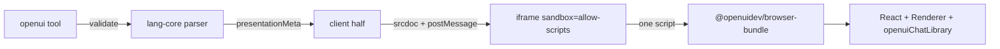

# @blaueck/dsh-openui

A [DSH](https://github.com/deepseek-ai/deepseek-harness) plugin that answers with a
**live UI instead of prose**. It registers one tool, `openui`, which takes an
[OpenUI Lang](https://openui.com/docs/openui-lang) program — the Open Standard for
Generative UI by [Thesys](https://github.com/thesysdev/openui) — validates it
against the official component catalog, and renders it as an interactive,
sandboxed card in the conversation.

The component catalog is the real one: `openuiChatLibrary`, **84 components**,
generated into this package at build time so the validator, the bundled skill and
the browser renderer can never disagree. It can also grow at runtime: the
`openui_component` tool registers a reusable **template** (a parameterized
composition of the built-in components) or a **React component** (code the card
frame evaluates and renders), persists it in the DSH profile, and documents it in
a generated `openui-components` skill that every later session can load.

```
root   = Card([header, chart, tbl])
header = CardHeader("Q4 Revenue", "Two product lines")
chart  = BarChart(labels, [s1, s2], "grouped", "Quarter", "k")
labels = ["Q1", "Q2", "Q3", "Q4"]
s1     = Series("Product A", [120, 150, 180, 210])
s2     = Series("Product B", [90, 110, 140, 165])
tbl    = Table([Col("Quarter", labels), Col("A", [120, 150, 180, 210], "number")])
```

## What it gives you

- **Dashboards, tables, charts, forms, step guides, mockups** — from the official
  catalog: `Card`, `CardHeader`, `TextContent`, `Table`, `BarChart`/`LineChart`/
  `PieChart`/`ScatterChart`, `Tabs`, `Accordion`, `Modal`, `Steps`, `Carousel`,
  `Callout`, `Form` with `Input`/`Select`/`Slider`/`DatePicker`/`Chips`/
  `OptionCards`, `Buttons`, and the card blocks (`SnippetCardBlock`,
  `OverviewCardBlock`, `ContextCardBlock`, `CompositeCardBlock`, `VisualCardBlock`).
- **Interactivity, with no network**: `$variables` are reactive, forms validate
  against their own `rules`, and a button whose action is `@ToAssistant("…")`
  sends that message back to you as a new user turn carrying the form's values.
- **Streaming by construction**: OpenUI Lang is re-parsed per chunk and supports
  forward references, so the card is built top-down while the model is still
  writing it. The frame mounts once and is fed, never remounted.
- **Replay-stable**: the program lives in the call's persisted
  `presentationMeta`, so a reloaded session redraws the same card without
  re-reading any file.
- **Cheap corrections**: `update` merges a `patch` into the recorded program *by
  statement name*, so fixing one line costs one line.
- **Findable when the turn folds**: a finished turn hides its process — every tool
  row, and the card inside it — behind the turn's duration summary, which made the
  card hard to find. The card is the turn's *output*, so it is shown again on the
  turn tail, under the closing answer, using the same seat the host's own
  deliverables and plan cards use.

### The turn tail, and why it does not check the fold setting

`dsh-visualize` hides its tail cards again when the reader's work-details mode is
`verbose`, because the host is then not folding and the card is already on screen.
This plugin deliberately skips that check. The preference lives behind a host
settings service whose 0.2 shape could not be verified from the packages available
to this build, and reading it wrongly would *suppress* the card — the exact
opposite of why the tail exists. The cost of skipping it is that in `verbose` mode
the card appears twice; that is the softer failure.

Nested `run_code` dispatches are collected too, but only their `create` form: a
nested `update` carries just a patch, and the program it patches is not reachable
from the collector. A *top-level* `update` does reappear, because its persisted
meta holds the merged program.

## Architecture

Three parts, deliberately separated:

| Part | File | Role |
| :--- | :--- | :--- |
| **Host half** | `src/tool.ts`, `src/library-spec.ts` | Validates the program against the generated catalog with `@openuidev/lang-core`, persists it as meta, writes a content-addressed card copy under the OS temp dir. |
| **Skill** | `skills/openui-skill.md` | The authoring contract the model loads first: the grammar, the 83-component catalog with positional argument order, and the DSH-specific call rules. Generated from the library itself. |
| **Browser half** | `src/client/*`, `src/shell.ts` | Registers the `openui` toolview and the turn tail, and renders each program in `<iframe sandbox="allow-scripts">`. |
| **Extensibility** | `src/registry.ts`, `src/store.ts`, `src/register-tool.ts`, `src/schema-extension.ts` | The `openui_component` tool, the profile registry, template expansion, the extended catalog schema, and the generated incremental skill. |

### Why the renderer runs in a frame, from one bundled script

The OpenUI React runtime is a React **19** application; the DSH shell runs React
**18**. Inside an opaque-origin frame that conflict simply does not exist: the
frame loads its own copy, and the two sides speak only `postMessage`. It also
means the library's ~320 kB of Tailwind-based CSS is quarantined instead of being
injected into the host document.

The frame loads **`@openuidev/browser-bundle`** — a single IIFE the OpenUI authors
ship for exactly this case, containing React, React-DOM, the renderer and the
component library. The renderer is not bundled into `lib/client.js` (about 220 kB
with the registry and the Remote codecs; the ~3.2 MB runtime stays in the frame).

This is not the obvious choice, and the obvious choice does not work. Loading
`react`, `react-dom/client`, `@openuidev/react-lang` and `@openuidev/react-ui` as
separate jsDelivr `+esm` modules **fails silently**: the `+esm` build of
`react-dom/client` rewrites its React peer — declared as the range `^19.3.0` — to
the literal URL `/npm/react@%5E19.3.0/+esm`, while `react-lang` imports
`/npm/react@19.3.0/+esm`. Same code, two URLs, so the browser instantiates React
twice and the renderer throws
`Cannot read properties of null (reading 'useInsertionEffect')` — at which point
the card paints nothing at all. One bundle makes that class of bug impossible.



### Catalog

The bundle exposes `window.__OpenUI = { React, createRoot, Renderer,
openuiChatLibrary }` — the **chat** library (root `Card`, 84 components). That is
what `scripts/gen-library.mjs` generates the validator and skill from, because
validating against the playground library (root `Stack`) would accept programs
the browser cannot resolve: `Stack` and `Modal` exist only there.

### Extending the catalog

The shipped 84 components are generated and frozen, but the runtime can be
extended. `openui_component` writes one manifest per component under the DSH
profile — `<DSH_PROFILE_DIR>/openui/components/<slug>.json` — and regenerates
`<DSH_PROFILE_DIR>/openui/openui-components.md`, which the plugin exposes as the
`openui-components` skill. A new session needs no restart: it lists the skill,
and the `openui` tool validates against the same registry.

Two kinds of component, because they solve different problems:

- **`template`** — one OpenUI Lang expression over the built-in catalog, with
  `{{prop}}` holes. It is expanded inline before validation and rendering. This
  is the cheap kind: no new runtime, no code evaluation, and it cannot do
  anything a hand-written program could not already do.
- **`react`** — a JavaScript function expression returning React elements, plus
  optional CSS. The frame evaluates it, adds it to the library with
  `openuiChatLibrary.extend({ components: { add } })`, and the Renderer then
  parses the program with that extended library. This is how the catalog gains
  genuinely new UI: layout, SVG, styling, local state, custom interactions.

Templates are on by default. **Code components are off by default** and require
the `allowCodeComponents` config flag; a registration attempt without it fails
with an explanation.

```text
# template: a parameterized card header
name:        FlightCard
props:       from:string, to:string, depart:string, price:number
template:    Card([CardHeader({{from}} + " → " + {{to}}, {{depart}}),
                   TextContent("$" + {{price}}, "large-heavy")])
example:     root = Card([f])
             f = FlightCard("SFO", "NRT", "10:30", 640)
```

```text
# react: a stat card with its own markup
name:      StatCard
props:     label:string, count:number
code:      (props) => React.createElement("div",
             { style: { padding: 16, borderRadius: 12,
                        border: "1px solid var(--openui-border-default)" } },
             React.createElement("div", { style: { fontSize: 12, opacity: 0.7 } }, props.label),
             React.createElement("div", { style: { fontSize: 28, fontWeight: 600 } }, props.count))
css:       /* optional; injected once into the frame */
```

The code form is deliberately plain JavaScript, not JSX: the frame has no
compiler, and asking the model to emit `React.createElement` keeps the contract
honest. `React` (the frame's own React 19) is in scope; hooks work because the
wrapper invokes the function as a component. The function is called as
`fn(props, context)`; `context.renderNode(value)` renders a nested catalog
element, and `window.__dshOpenUI.toAssistant(text)` sends a message back to the
assistant. It cannot call host tools directly — those still go through the
program's gated `Query()`/`Mutation()` path.

The host never executes component code. It compiles it with `new Function` (which
parses without running), builds a JSON Schema from the declared props, and
validates programs against that schema; the code itself only runs inside the
frame. Each card also **snapshots the definitions it used** into its persisted
`presentationMeta`, so replay keeps rendering the same component after the
registry is edited or the component is removed.

### Theming

The library ships 228 `--openui-*` tokens whose light and dark halves differ only
in polarity, and whose `sunk`/`elevated` surfaces are the foreground at 4–8 %
alpha. Rather than restate them, `src/frame-css.ts` derives every derived token
with `color-mix()` from the handful of primitives the card resolves out of the
live DSH theme (`--dsw-alias-*`). One rule set, correct in both appearances.

The frame keeps `color-scheme: light dark` on purpose: the library flips its own
palette inside a `prefers-color-scheme` media query, which a `color-scheme` value
cannot override, so pinning the frame to one appearance would let the library
pick dark text while the fallbacks stayed light — white on white.

### Frame CSP

`script-src` carries `'unsafe-eval'`, and that is load-bearing: the component
library reaches the frame through `react-syntax-highlighter`, whose `refractor`
dependency evaluates code at module-init time, and it is also what lets a
registered React component be compiled with `new Function`. Without the
allowance the import throws an `EvalError` and the card stays blank. The frame is
still an opaque origin with `default-src 'none'`, no nested frames, no form
posts, and exactly one reachable network origin.

## Install

```bash
pnpm add link:/path/to/dsh-openui
```

Then add `"@blaueck/dsh-openui"` to `dsh.profile.bundles` in the profile's
`package.json`, or let the plugin manager do both:

```bash
dsh plugin install link:/path/to/dsh-openui
```

The host half takes effect immediately. The browser half is served at
`/api/plugins/<entry id>/client.js` and is picked up on the next page load.

## Configuration

| Option | Default | Meaning |
| :--- | :--- | :--- |
| `maxSourceBytes` | `256000` | Size ceiling for one program. A larger program is rejected with guidance to downsample the data it inlines. |
| `customComponents` | `true` | Registers the `openui_component` tool and the local registry. |
| `allowCodeComponents` | `false` | Allows `react` registrations (model-authored code evaluated in the card frame). When false, existing code components are hidden from the tool, the skill and the registry served to the browser half; cards already in the transcript still replay their snapshotted definitions. Templates keep working. |
| `componentsDir` | `''` | Registry directory. Empty means the running profile's `openui/components`, resolved from the live HMR profile root and then `DSH_PROFILE_DIR`; a relative path resolves against that root. Pin it explicitly when the host process does not export `DSH_PROFILE_DIR`. |
| `maxComponents` | `200` | Maximum registrations one profile may hold. |

## The `openui` tool

| Parameter | Meaning |
| :--- | :--- |
| `title` | Card title. Defaults to `OpenUI`; required on `update`. |
| `mode` | `inline` (default) or `wide`. |
| `action` | `create` (default) or `update`. |
| `source` | `create`: the whole program. |
| `path` | `update`: the card to patch, as its own call reported it. |
| `patch` | `update`: statements to add or replace, merged by name. |

A rejected program returns the parser's own findings, each naming the offending
statement and what to change — with a near-miss suggestion for a mistyped
component name.

## The `openui_component` tool

| Parameter | Meaning |
| :--- | :--- |
| `action` | `register` (default), `update`, `remove`, or `list`. |
| `name` | PascalCase component name, e.g. `FlightCard`. |
| `description` | One sentence on when to use it; shown in the generated skill. |
| `props` | Positional arguments in call order: `{ name, type, required? }`. `type` is `string`, `number`, `boolean`, `json`, `array`, `children`, `component` or `any`. |
| `template` | Template kind: one OpenUI Lang expression with `{{prop}}` holes. |
| `code` | React kind: a JavaScript function expression `(props, context) => React element`. Requires `allowCodeComponents`. |
| `css` | React kind: optional stylesheet injected once into the frame. |
| `example` | Optional complete program demonstrating the component; validated and shown in the skill. |

A registration is validated before it is written: the name must not collide with
the catalog or an existing registration, every declared prop must be used, the
template must expand to a valid program, the code must compile, and the example
must render. Anything rejected comes back with the offending part named.

## Security of code components

`react` components are model-authored JavaScript, so they are opt-in. They run
inside the same `<iframe sandbox="allow-scripts">` as every card, at an opaque
origin: no session, no cookies, no host DOM, no access to the parent page. The
frame's CSP still allows exactly one network origin (`cdn.jsdelivr.net`) plus
`https:` images.

Inside the frame, code can render, style, keep local state, and call
`window.__dshOpenUI.toAssistant(text)` — the same `continue_conversation` step a
catalog `Button` carries. It can also observe the frame protocol (the per-card
token rides every parent message), which means it could forge the same card
actions and card-initiated tool calls any program can make; those still hit the
host's allowlists and approval policy, and it still cannot reach a host service,
read a file, or address another session directly. The human-facing risk is
therefore mostly trust in the UI itself: review the code before enabling it, keep
`allowCodeComponents` off if you do not, and remember that a registration is a
visible tool call in the transcript.

## Development

```bash
pnpm gen        # regenerate schema + system prompt + skill from the installed library
pnpm typecheck  # both halves
pnpm test       # 117 specs
pnpm build      # tsdown: lib/index.js (ESM) + lib/client.js (browser)
pnpm check      # all of the above
```

`scripts/gen-library.mjs` imports `openuiChatLibrary` in Node and emits:

- `src/generated/library.schema.json` — the `LibraryJSONSchema` the validator parses against
- `src/generated/library-meta.json` — bundle/UI versions, root component, component names
- `src/generated/system-prompt.md` — the library's own generated system prompt
- `skills/openui-skill.md` — that prompt wrapped in the DSH-specific contract

The generator reads the pinned bundle version straight out of
`OPENUI_RUNTIME` in `src/shell.ts`, so the version stamped into the skill cannot
drift from the version the frame loads.

### Verifying the frame without a browser window

Two scripts drive real headless Chrome over the DevTools Protocol, because the
failures this plugin actually hit — a dual-React dispatcher error, an `eval`
blocked by CSP — are invisible to unit tests:

```bash
node scripts/verify-frame.mjs   [program.openui]   # the card's iframe + postMessage protocol
node scripts/verify-render.mjs  [program.openui]   # the real frame doc, its DOM, and a screenshot
```

Both print the frame protocol transcript and every console message, and write a
PNG to `/tmp`.

**To bump the runtime**: update the pinned URLs in `src/shell.ts`, update
`@openuidev/react-ui` to the matching version, then `pnpm gen && pnpm check`. If
the frame ever goes blank again, reach for `verify-render.mjs` first — it shows
the browser's own error.

## Live data: `Query()` and `Mutation()`

A card can run host tools while it is on screen. The browser never touches a
tool directly: the frame posts a request, the client half forwards it over the
Typert Remote bridge, and the node half runs it through `ctx.tools.execute` —
which means the ordinary approval and policy pipeline applies.

Two allowlists, **both empty by default**:

```yaml
- id: dsh-openui
  config:
    allowedTools: ['glob', 'grep']   # what Query() may call
    writableTools: []                # what Mutation() may call
```

Empty is the shipped posture on purpose. A card re-runs its queries on its own —
a variable change, a `refreshInterval` — and neither the results nor the call
itself enter the model's context or the session log, so there is no audit trail.
Point a card at a tool that writes and it can write repeatedly with nothing
recording it. `glob` is the safe end of what a card may be trusted with.

### How a call is attributed to a list

The renderer's `toolProvider` carries **no statement identity** — it hands over a
tool name and arguments, and nothing says whether a `Query()` or a `Mutation()`
asked. The frame cannot work it out from the renderer's `onParseResult` either:
that fires in an effect *after* the first queries have already run, so the very
first fetch would be attributed to the wrong allowlist.

So the **host decides**. It already parses the program to validate it, and it
records the split in the card's meta as `readTools` / `writeTools`; the client
half hands those to the frame, and the frame attributes each call from them. A
name in neither list is treated as a write — the stricter side. For paths with no
host parse (a still-streaming call, a nested `run_code` dispatch) the frame falls
back to the renderer's own parse callback.

### The client half must declare `remote`

Cordis guards service access per namespace: a plugin may hold a reference to a
service it never declared, but reading a property off it throws
`cannot get property "remote.openui" without inject`. This plugin mounts its own
contribution **and** reads it, so:

- `remote` is a **static** dependency in `src/client/index.tsx`. Only the static
  form grants access; a dynamic `ctx.inject(['remote'], …)` did not.
- `remote.openui` cannot be static — this plugin is what creates it, so waiting
  on it up front deadlocks. It is read through a declared scope and directly, and
  whichever the guard accepts is what carries it.

If you copy this pattern into another package, plan for that asymmetry: declare
every namespace you read **except** the one you mount yourself.

## Known limits

- **A card cannot use `Query()`/`Mutation()` until an operator lists the tool.**
  With both allowlists empty — the default — a program still renders, and each
  query falls back to its own `defaults` argument.
- **Under `mode: 'ptc'` this path is unverified.** A tool call with no `parent`
  token is rejected as `UNKNOWN_TOOL` there, and a Remote call has no parent.
- **`Mutation()` is gated but not approved.** A card-initiated write runs through
  the normal tool pipeline, so an operator's approval rules apply — but nothing
  shows the user a diff before it happens. Keep `writableTools` empty unless the
  card is one you trust.
- **The card needs network access to `cdn.jsdelivr.net`.** The whole runtime is
  one 3.2 MB IIFE, cached by the browser after the first card. To self-host,
  repoint `OPENUI_RUNTIME` in `src/shell.ts`, widen `FRAME_CSP`, and serve the
  files from the plugin's own route.
- **`Stack` and `Modal` are not available** — they exist only in the playground
  library, which the shipped bundle does not carry. Use `Card` for layout; it
  takes the same `direction`/`gap`/`align`/`justify`/`wrap` arguments. `Modal` is
  absent, so build overlays with `Tabs`/`Accordion` instead.
- **`EditableTable` edits** are collected into form state and returned only when
  the program pairs them with a submit button.
- **Registered components belong to the profile, not the project.** Every session
  in the profile sees them; a different profile or a headless client without the
  browser half does not. They live under `<DSH_PROFILE_DIR>/openui/`, outside any
  workspace.
- **Editing a registration is forward-only.** Existing cards replay from the
  definitions snapshotted in their own meta, so changing or removing a component
  does not rewrite the transcript; new cards use the new definition.
- **Code components are not JSX and cannot import modules.** The value is one
  function expression; `React` is in scope, hooks work, and external code has to
  be inlined. They also cannot call host tools — only the program's gated
  `Query()`/`Mutation()` path can.
- **The frame's schema borrowing tracks the bundle.** A registered component's
  prop schema is borrowed from existing catalog components (the bundle exposes no
  zod or `defineComponent`), so a bundle upgrade that renames those internal
  shapes would make code components fail to load — visibly, and without taking
  the built-in catalog down.

## License

MIT. OpenUI (`@openuidev/*`) is MIT, © Thesys Inc.
